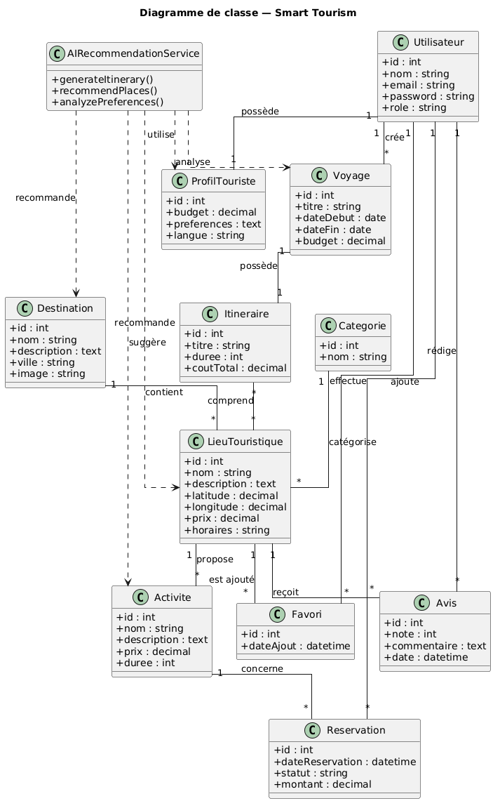

<!-- _class: title -->

  
  

# Présentation de projet
## 🌍 Smart Tourism

Plateforme web de découverte et d'organisation de voyages
**Présenté par** : Mohammed Yassir Mesbahi
**Encadré par** : ES-Sarraj Fouad

---

## Remerciements

- Équipe pédagogique et formateurs
- Encadrants et membres du jury
- Famille, collègues et camarades de formation

<!-- À personnaliser : noms des personnes à remercier -->

---

## Introduction

- Le tourisme repose de plus en plus sur le numérique
- Les voyageurs cherchent une information fiable, rapide et centralisée
- **Smart Tourism** : une plateforme pour découvrir, sauvegarder et planifier

---

## Contexte du projet

- Informations touristiques **dispersées** entre plusieurs sites
- Difficile de trouver des destinations, comparer des activités, organiser un séjour
- Première version (MVP) centrée sur :
  - l'expérience du **touriste**
  - la gestion du contenu par un **administrateur**

---

## Objectif de formation (Solicode)

- Concevoir et développer une application web complète
- Séparer **Frontend** et **Backend**
- Appliquer la POO, le pattern DAO et une architecture en couches
- Travailler avec une méthode de gestion de projet et une démarche de conception

---

## Cahier des charges

- **Cible** : voyageurs et administrateur
- **Fonctionnalités clés** : destinations, lieux, activités, favoris, avis, voyages, administration
- **Contraintes** : français, affichage mobile / tablette / ordinateur, espace admin sécurisé
- **Hors MVP** : hébergements, restaurants, guides, transport, réservation et paiement

---
<!-- _class: image-only -->
# Les Méthodes  

## Scrum

---
<!-- _class: image-only -->

## Processus 2TUP

---
<!-- _class: image-only -->

## Design Thinking

---

## Planification

- Livraison par **sprints** (méthode Scrum)
- Priorité 1 : destinations, lieux, activités, catégories
- Priorité 2 : favoris, avis et évaluations
- Priorité 3 : voyages et étapes, espace d'administration

<!-- À compléter : dates et durée des sprints -->

---

## Branche fonctionnelle

- 🗺️ **Destinations**
- 📍 **Lieux touristiques**
- 🎯 **Activités**
- ❤️ **Favoris**
- ⭐ **Avis et évaluations**
- 🧳 **Trip Planner**
- 🤖 **Recommandations**
- 🛠️ **Administration**

---

## Carte d'empathie

- **Pense** · « Je veux un séjour réussi, sans perdre de temps »
- **Ressent** · Perdu devant trop de sources d'information
- **Dit** · « Où aller ? Que faire ? Comment organiser tout ça ? »
- **Fait** · Compare plusieurs sites, note ses idées à la main

---
<!-- _class: dark -->

## Définition du problème

- Le voyageur **perd du temps** à chercher et recouper des informations
- Il n'a pas d'endroit unique pour **garder** ses lieux et activités préférés
- L'organisation d'un séjour (dates, horaires, ordre de visite) est **manuelle**

---

## Idéation

- Une plateforme **unique** pour toute l'information touristique
- Des **favoris** et des **avis** pour choisir en confiance
- Un **planificateur de voyage** par date, heure et ordre de visite
- Des **recommandations** selon les centres d'intérêt

---

## Diagramme de cas d'utilisation

- **Touriste** · consulter destinations, lieux, activités · gérer ses favoris · publier un avis · créer et organiser un voyage
- **Administrateur** · gérer utilisateurs, destinations, catégories, lieux, activités

---

## Stack technologique

- **Frontend** · HTML5 · Tailwind CSS · JavaScript Vanilla · Fetch API
- **Backend** · PHP 8+ · POO · PDO
- **Architecture** · Controller · Service · DAO
- **Base de données** · MySQL

---

## Architecture

**Présentation** → **Logique métier** → **Accès aux données**

Navigateur · HTML / JavaScript

↓ Fetch API · HTTP / JSON

PHP · Controllers · Services · DAO

↓ PDO

MySQL · `smart_tourism`

---

## Périmètre du MVP

- Destinations · Catégories · Lieux touristiques · Activités
- Favoris · Avis et évaluations
- Voyages et étapes de voyage
- Espace d'administration

---

## Relations des données

- **Destination** → plusieurs lieux et plusieurs activités
- **Catégorie** → plusieurs lieux et plusieurs activités
- **Utilisateur** → plusieurs favoris, avis et voyages
- **Voyage** → plusieurs étapes (lieu ou activité)

---

## Base de données

- Base `smart_tourism` · **12 tables**
- `utilisateur` · `destination` · `categorie`
- `lieu_touristique` · `activite`
- `favori_lieu` · `favori_activite`
- `avis_lieu` · `avis_activite`
- `voyage` · `etape_lieu` · `etape_activite`

---

## Structure technique

- **Frontend** · HTML · CSS / Tailwind · JavaScript
- **Backend** · PHP · Controllers · Services · DAO
- **API** · JSON via Fetch API
- **Données** · MySQL

---

## Sécurité

- Requêtes préparées (PDO)
- Mots de passe hachés (`password_hash`)
- Validation des données côté Backend
- Routes d'administration protégées
- CORS limité aux origines nécessaires

---

<!-- _class: image-only -->
## Diagramme de classes

---

## Maquettes

<!-- À remplacer par les images des maquettes -->

---

## Interfaces

- Accueil et liste des destinations
- Fiche destination · lieux · activités
- Favoris et avis
- Trip Planner
- Espace d'administration

<!-- À remplacer par les captures d'écran -->

---
<!-- _class: dark -->

## Conclusion

- Plateforme fonctionnelle pour découvrir, sauvegarder et planifier un voyage
- Base solide et évolutive, avec séparation Frontend / Backend
- Évolutions possibles · hébergements · restaurants · guides · transport · réservation · paiement en ligne · recommandations avancées
